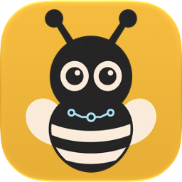
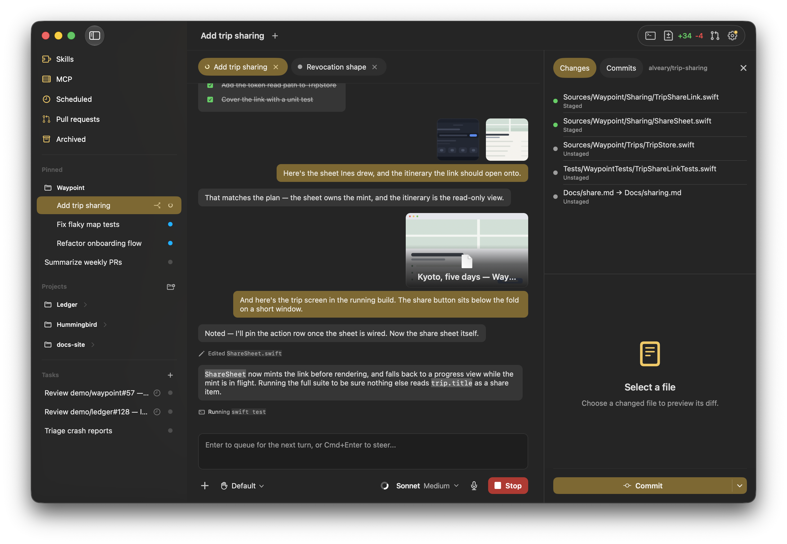

<p align="center">
  <picture>
    <source srcset="docs/images/app-icon-dark.png" media="(prefers-color-scheme: dark)">
    
  </picture>
</p>

<h1 align="center">Alveary</h1>

<p align="center">A native macOS app for orchestrating AI coding agents.</p>

<p align="center">
  <a href="https://github.com/afollestad/alveary/releases/latest/download/Alveary.app.zip">
    
  </a>
</p>

_An alveary is a place where bees are kept, including a beehive or apiary enclosure._

Alveary is inspired by other apps like OpenAI's Codex, and works with Claude Code, Codex, and OpenCode.



## Download

Alveary needs a Mac with Apple silicon, on macOS 26 or later. Download `Alveary.app.zip` from the [latest release](https://github.com/afollestad/alveary/releases/latest), unzip it, and move `Alveary.app` to `/Applications`. Then launch it and follow the onboarding checks.

## User guide

- [Harnesses](docs/harnesses.md): Claude Code, Codex, and OpenCode, and their models
- [Projects and source folders](docs/projects.md): grouping folders, thread workspaces, and worktrees
- [Scheduled tasks](docs/scheduled-tasks.md): callbacks and recurring runs
- [Pull requests](docs/pull-requests.md): ignoring, agent and team reviews, and attachments
- [Menu bar](docs/menu-bar.md): recent threads, reviews waiting on you, and launching at startup
- [Voice input](docs/voice-input.md): on-device English dictation

## Roadmap

The public backlog and roadmap are tracked in the [Alveary project board](https://github.com/users/afollestad/projects/3).

## Development

Alveary is built with XcodeGen, `xcsift`, SwiftLint, Needle, AgentCLIKit, BlockInputKit, FluidAudio, and SwiftTerm, with pull request status glyphs from Primer Octicons. Run setup once per clone, and regenerate the Xcode project after changing its structure:

```sh
./scripts/setup.sh
xcodegen generate
```

```sh
./scripts/build.sh                               # Build the app
./scripts/lint.sh                                # Lint the source
./scripts/run.sh -b                              # Build and run the app (omit -b to run the last build)
./scripts/run.sh --demo                          # Run a debug build on fake data in its own profile, reseeded each launch
./scripts/test.sh                                # Run the whole test suite
./scripts/test.sh AlvearyTests/AppDelegateTests  # Run one test class
```

Debug builds use `com.afollestad.alveary.debug` and appear as **Alveary Dev**, sharing tasks, settings, and support files with release builds. macOS asks for their notification and privacy permissions separately.

[RELEASING.md](RELEASING.md) covers releases.

## License

Alveary is licensed under the [GNU General Public License v3.0](LICENSE.md).
